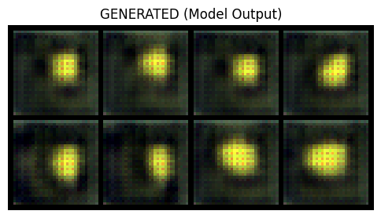
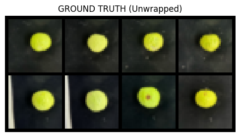

# Guava Image Translation with VQ-VAE

A **Vector-Quantized Variational Autoencoder (VQ-VAE)** in **PyTorch** trained to transform photographs of wrapped guavas into unwrapped-image targets. This is a small-scale machine learning experiment using photographs collected by the author.

## Sample outputs from the original experiment

The following plots were extracted from the original notebook (not regenerated here).

| Wrapped input | VQ-VAE output | Unwrapped target |
|---|---|---|
| [Wrapped validation samples](results/wrapped_inputs.png) |  |  |

## Dataset

- **10 training pairs** and **10 validation pairs** (40 JPEG images total)
- Each pair has matching filenames in `wrapped/` and `unwrapped/`
- Original, author-collected guava photographs; paired samples included in `dataset/`
- Image preprocessing: EXIF orientation correction, cropping the top 15%, resizing to **32 × 32**, and normalization

```text
dataset/
  train/wrapped/       train/unwrapped/
  val/wrapped/         val/unwrapped/
```

## Model and training

- PyTorch encoder → **64-entry vector-quantization codebook** (embedding dimension 32) → decoder, with residual blocks
- **200 optimizer steps**, batch size **8**, Adam (learning rate **0.001**)
- Training objective: normalized reconstruction MSE + vector-quantization loss
- Training code logs mean reconstruction error and codebook perplexity every 50 steps

### Training progress saved in the original notebook

| Step | Mean reconstruction error (last 50 steps) | Mean perplexity (last 50 steps) |
|---:|---:|---:|
| 50 | 2.0072 | 1.00 |
| 100 | 0.9871 | 1.06 |
| 150 | 0.7492 | 1.84 |
| 200 | 0.3905 | 2.08 |

### Validation metrics saved in the original notebook

| Metric | Recorded value |
|---|---:|
| Structural Similarity Index (SSIM) | **0.458** |
| Peak Signal-to-Noise Ratio (PSNR) | **17.99 dB** |

These values and logs are **saved outputs from the original experiment**, not independently reproduced results. Open `VAE.ipynb` to see the corresponding execution output. The evaluation code runs again after training and **prints fresh SSIM and PSNR**; values may differ across runs. With only 10 validation pairs, these numbers do not establish performance on a broader dataset.

## How to run

1. Clone this repository:

   ```bash
   git clone https://github.com/Burcu-weining/Guava-VQ-VAE-Image-Translation.git
   cd Guava-VQ-VAE-Image-Translation
   ```
2. Use a suitable Python environment, install compatible PyTorch and torchvision, then install the dependencies:

   ```bash
   pip install -r requirements.txt
   ```
3. Open `VAE.ipynb` in Jupyter, VS Code, or Colab (after cloning the repository). Run the cells **in order** from the repository root.
4. The notebook prints the device, dataset counts, data variance, training progress at steps 50/100/150/200, and validation SSIM/PSNR; it displays the wrapped inputs, generated outputs, and targets.

No Google Drive mount is required: the notebook uses the included `dataset/` folder. Training was **not rerun** while packaging this repository.

## Limitations

- Small dataset; generalization has not been established.
- The code resamples batches over 200 steps rather than iterating through 200 full epochs.
- Saved experiment outputs are provided, but trained model weights are not included. Rerunning training is required to evaluate a newly initialized model.
- The `decay` argument is passed when creating the model but the original code uses the standard vector quantizer, not EMA codebook updates.

## Repository structure

```text
VAE.ipynb              # Model, training, sample plots, and numerical evaluation
dataset/               # Original wrapped/unwrapped photo pairs
results/               # Saved plots extracted from original notebook
README.md
requirements.txt
.gitignore
```
